# Data Gateway Desktop

Aplicativo desktop (Windows) que transforma tabelas de bancos de dados existentes em **APIs REST seguras**, configuradas visualmente — sem escrever SQL e sem expor o banco à internet.

**Stack:** Electron 37 · React 18 · Vite 5 · JavaScript · Node.js · SQLite (better-sqlite3) · CSS
**Bancos suportados:** SQL Server · PostgreSQL · MySQL · MariaDB · **Firebird** (2.5 a 5.0, dialeto 1 e 3) · SQLite

---

## Capturas de tela

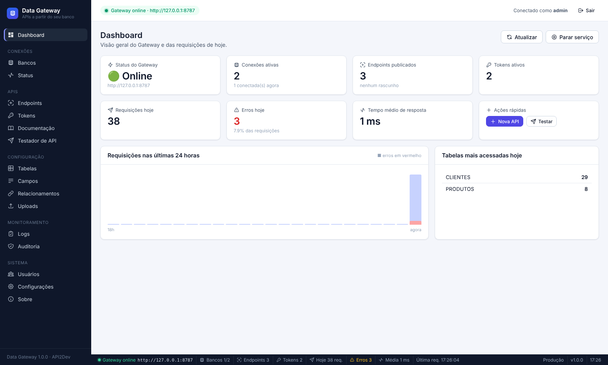

<table>
  <tr>
    <td width="50%">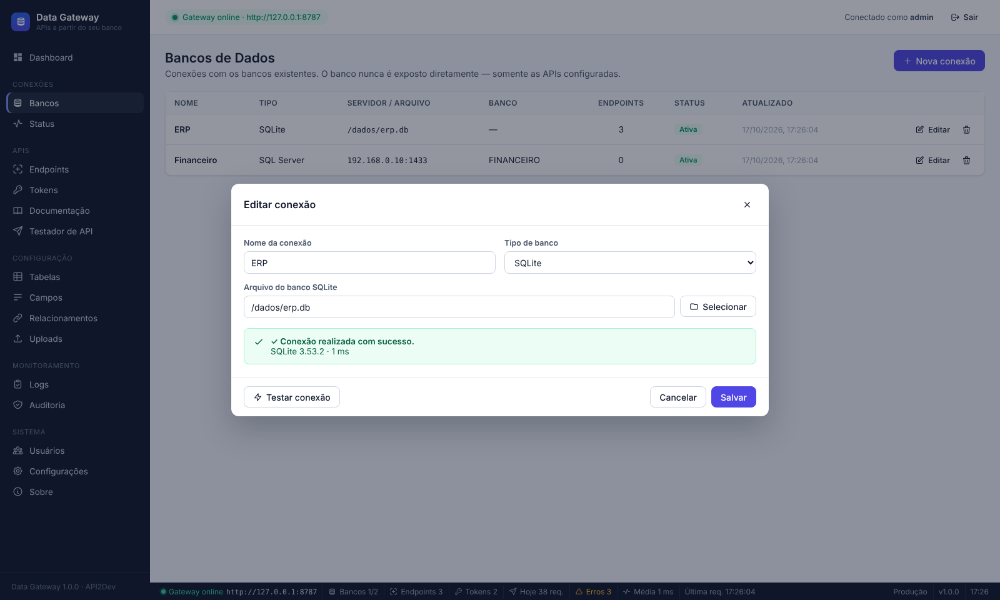<br><sub><b>Conexões</b> — cadastro e teste de conexão</sub></td>
    <td width="50%">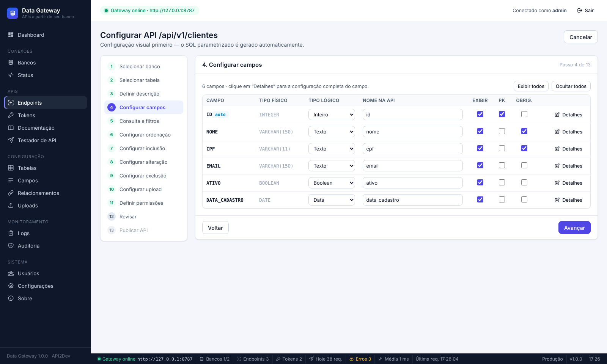<br><sub><b>Assistente</b> — configuração dos campos (tipo físico × tipo lógico)</sub></td>
  </tr>
  <tr>
    <td>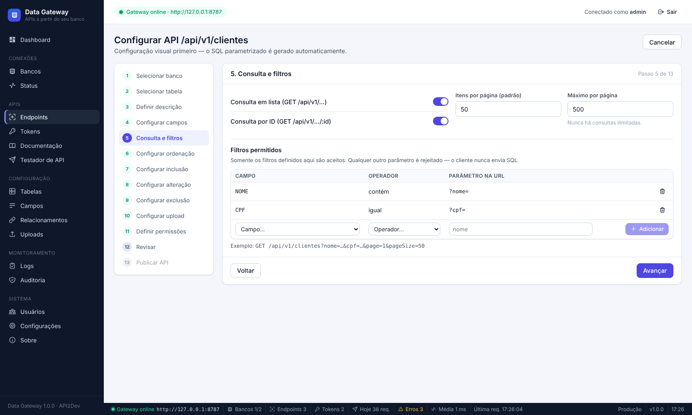<br><sub><b>Assistente</b> — consulta, paginação e filtros permitidos</sub></td>
    <td>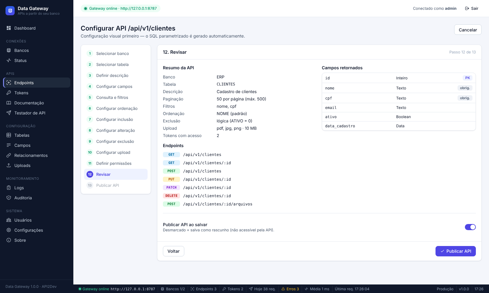<br><sub><b>Assistente</b> — revisão antes de publicar</sub></td>
  </tr>
  <tr>
    <td>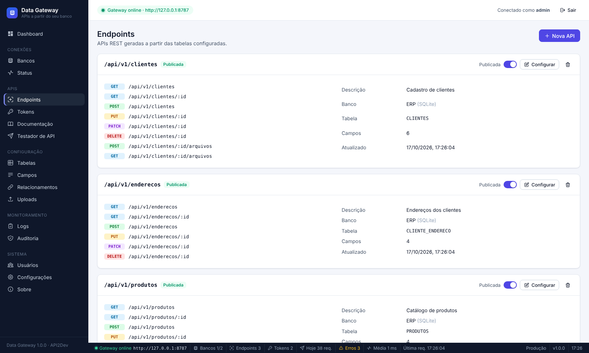<br><sub><b>Endpoints</b> publicados</sub></td>
    <td>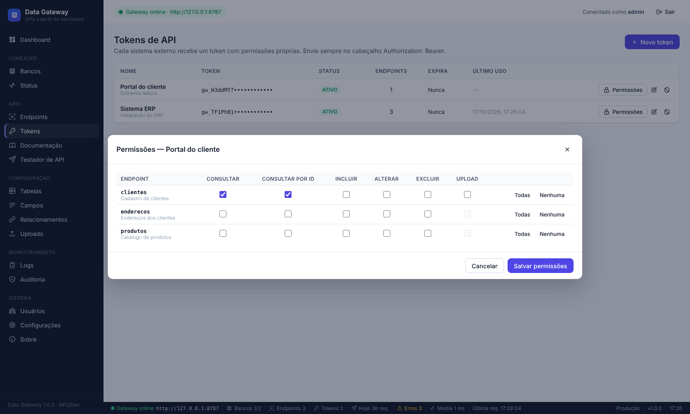<br><sub><b>Tokens</b> — permissões por endpoint e operação</sub></td>
  </tr>
  <tr>
    <td>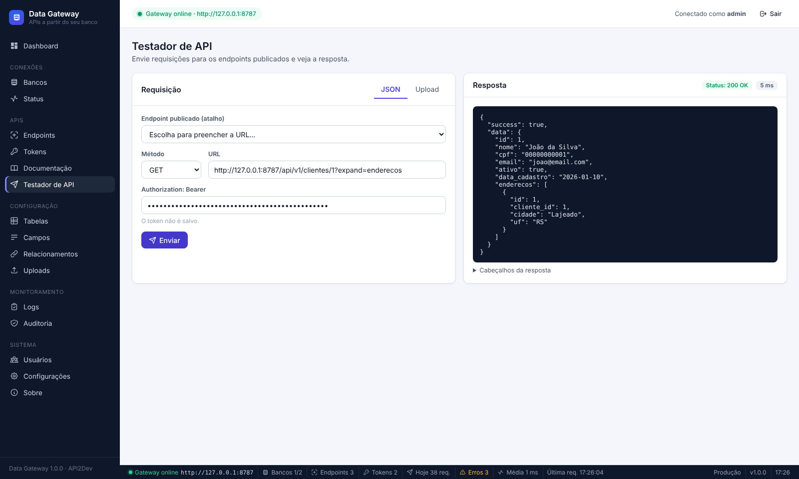<br><sub><b>Testador de API</b> com relacionamento (<code>?expand=</code>)</sub></td>
    <td>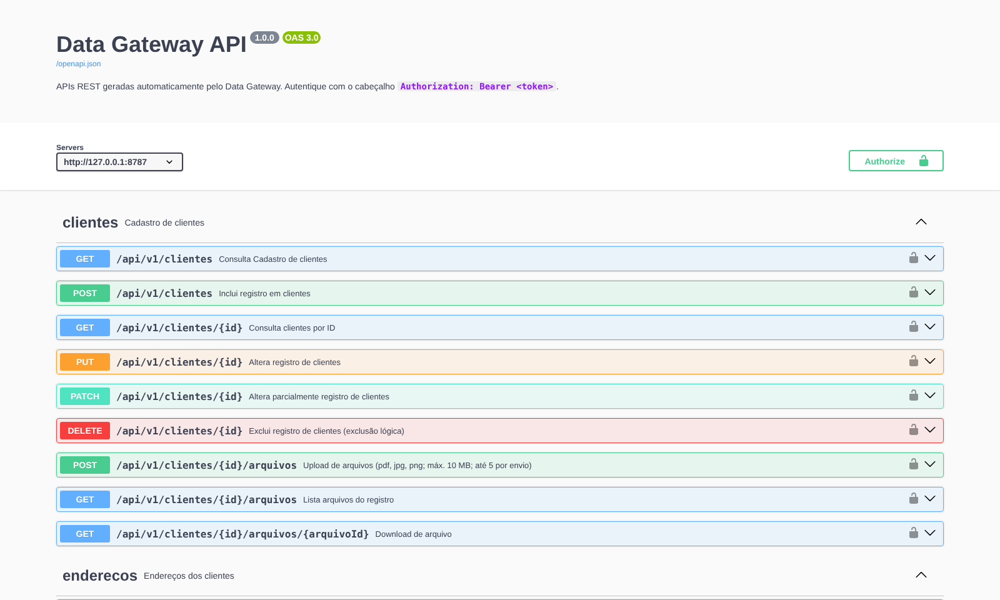<br><sub><b>Documentação</b> OpenAPI 3 / Swagger UI gerada automaticamente</sub></td>
  </tr>
  <tr>
    <td>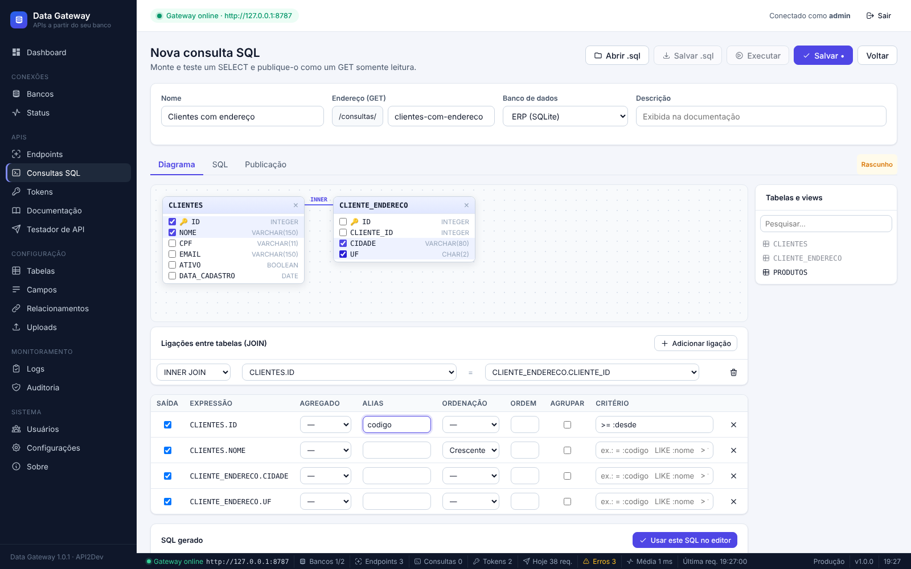<br><sub><b>Consultas SQL</b> — montador visual com ligações por chave estrangeira</sub></td>
    <td>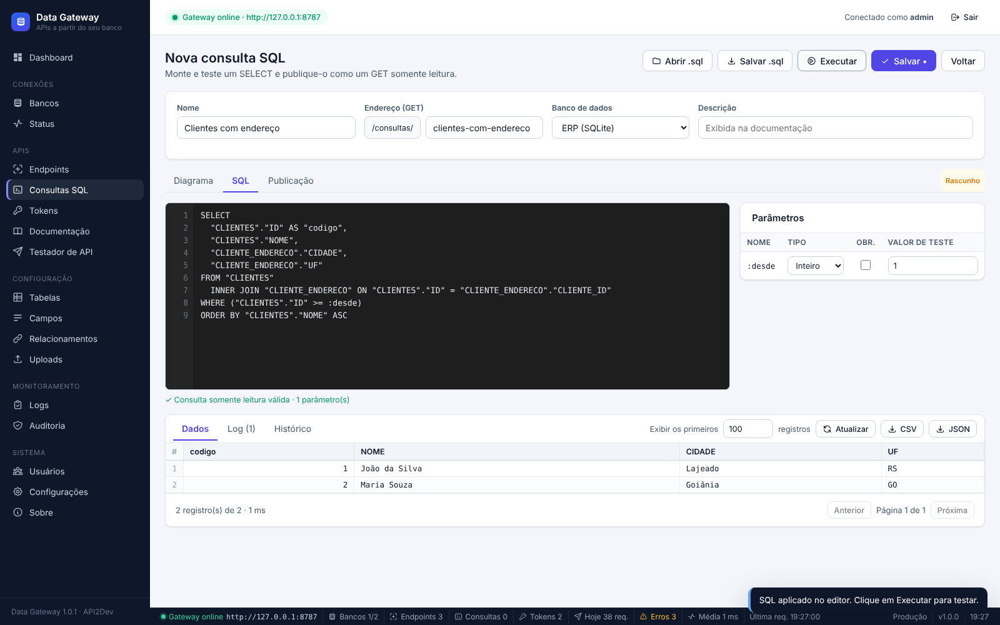<br><sub><b>Consultas SQL</b> — editor, parâmetros e resultado do teste</sub></td>
  </tr>
  <tr>
    <td>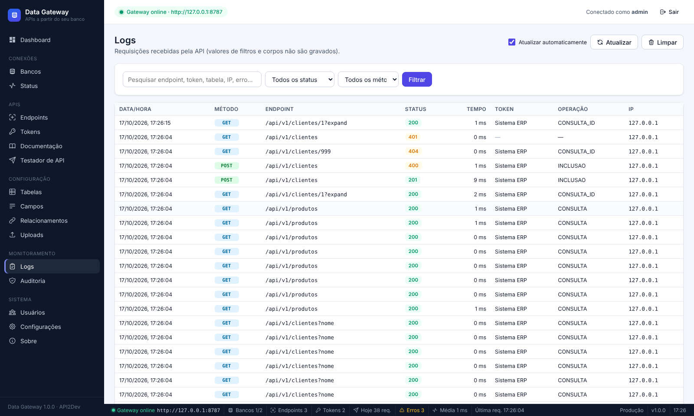<br><sub><b>Logs</b> de requisições</sub></td>
    <td>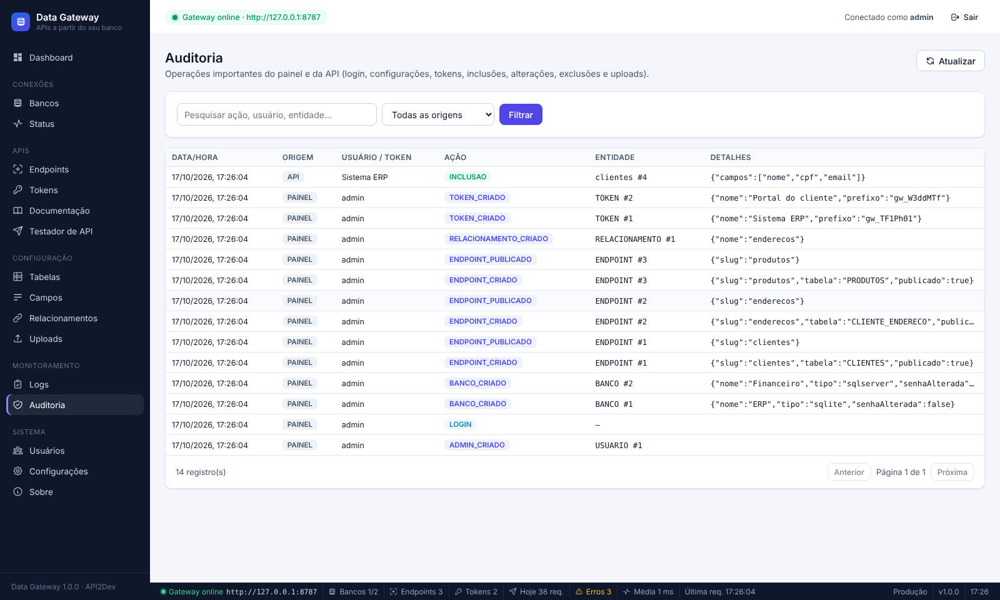<br><sub><b>Auditoria</b> do painel e da API</sub></td>
  </tr>
  <tr>
    <td>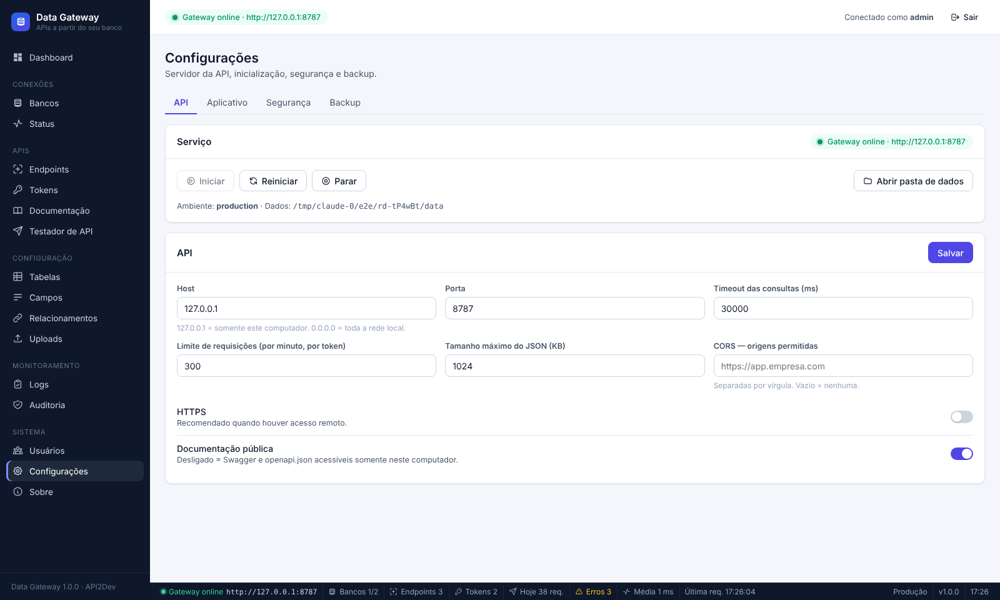<br><sub><b>Configurações</b> do servidor da API</sub></td>
    <td>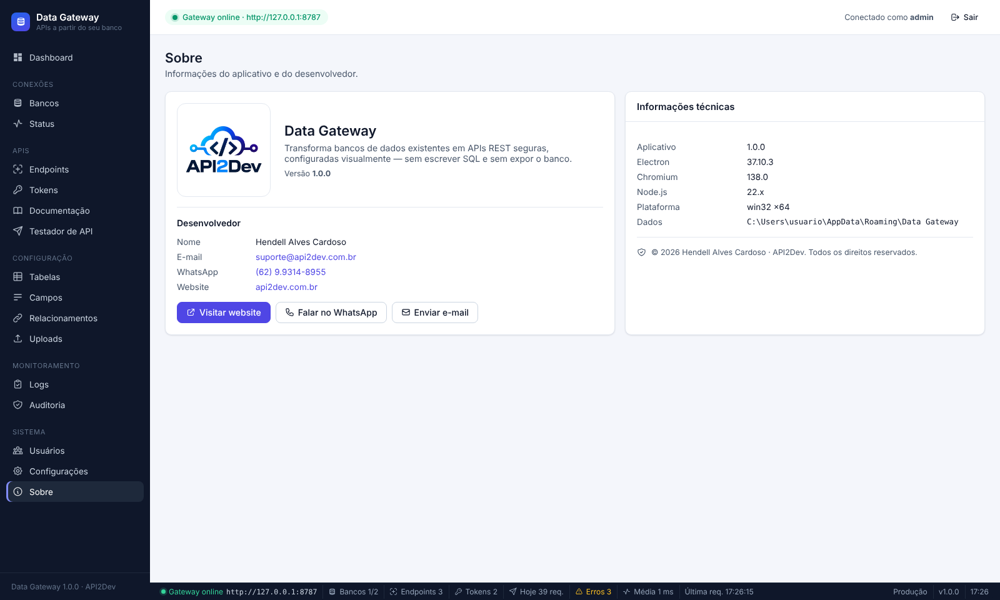<br><sub><b>Sobre</b></sub></td>
  </tr>
</table>

## Download

Baixe a versão mais recente em **[Releases](https://github.com/hendellacardoso/api-gateway-desktop/releases/latest)**:

- `DataGateway-Setup-<versão>.exe` — instalador (atalhos, desinstalador, escolha da pasta).
- `DataGateway-Portable-<versão>.exe` — executável portátil, sem instalação.
- `SHA256SUMS.txt` — hashes para conferir os arquivos.

Os executáveis são compilados pelo GitHub Actions a partir deste repositório e assinados digitalmente.
Free code signing provided by [SignPath.io](https://about.signpath.io), certificate by [SignPath Foundation](https://signpath.org)
— veja a [Code signing policy](CODE_SIGNING_POLICY.md).

---

## Como executar

Pré-requisitos: **Node.js 20 ou 22** (LTS) no Windows.

```bash
npm install          # instala dependências e compila o better-sqlite3 para o Electron (postinstall)
npm run dev          # Vite (painel) + Electron com recarga do painel
```

Na primeira execução o app pede a criação do **usuário administrador**.

### Enviar para o GitHub

Dê dois cliques em `enviar-git.bat`. Na primeira vez ele inicializa o repositório, configura o remoto
`https://github.com/hendellacardoso/api-gateway-desktop.git`, pede nome/e-mail (se ainda não configurados) e a mensagem do commit,
e faz o `push` para a branch `main`. `node_modules`, `dist`, `release` e bancos `.db` ficam fora (via `.gitignore`).

### Publicar uma versão (GitHub Actions)

1. Atualize `"version"` no `package.json` (ex.: `1.2.1`) e envie com `enviar-git.bat`.
2. Crie a tag da versão: `git tag v1.2.1` e `git push origin v1.2.1` (ou use `publicar-versao.bat`).
3. O GitHub Actions compila, roda os testes, envia para assinatura no SignPath e, depois da sua aprovação lá,
   cria o Release com os executáveis assinados. Veja [ASSINATURA.md](ASSINATURA.md) para a configuração inicial.

### Gerar o instalador (.exe) localmente

Dê dois cliques em `gerar-instalador.bat` (ou rode `npm run dist`). São gerados em `release/`:

- `DataGateway-Setup-1.2.0.exe` — instalador NSIS
- `DataGateway-Portable-1.2.0.exe` — executável portátil
- `win-unpacked/Data Gateway.exe` — aplicativo descompactado

Os executáveis (~100 MB) **não vão para o Git** (limite de 100 MB por arquivo do GitHub; a pasta `release/` está no `.gitignore`).
Para distribuir, publique-os em **GitHub → Releases → Draft a new release** e anexe os `.exe`.

O instalador (NSIS): instala o aplicativo, cria atalhos (Área de Trabalho e Menu Iniciar), permite escolher a pasta e cria o desinstalador.
O diretório de dados é criado no primeiro uso em `%APPDATA%\Data Gateway` (banco interno, chave mestra e uploads).
Em desenvolvimento (`npm run dev`) é usada uma pasta separada, `%APPDATA%\Data Gateway (Dev)`, para não misturar testes com a instalação real.
Para reiniciar do zero (novo administrador), feche o app pelo Tray → Sair e apague a pasta de dados correspondente.
A opção **Iniciar com Windows** é controlada pelo próprio app (Tray ou Configurações) e abre o Gateway minimizado (`--hidden`).

> Ícone gerado a partir de `imagens/logotipo.png`: `build/icon.ico` (executável, instalador e atalhos), `assets/icon.ico`/`icon.png` (janela) e `assets/tray.png` (bandeja, apenas o símbolo da nuvem para ficar legível em 16–32 px).

---

## Arquitetura

```text
src/
├── main/                    Electron Main Process
│   ├── main.js              ciclo de vida, instância única, inicialização do serviço
│   ├── window.js            BrowserWindow seguro (contextIsolation, sandbox, CSP)
│   ├── tray.js              menu do System Tray
│   ├── ipc/handlers.js      canal IPC único com whitelist de ações + sessão no main
│   └── services/startup.js  iniciar com o Windows
├── preload/preload.js       expõe somente window.gateway.invoke / on
├── renderer/                React (painel)
│   ├── pages/               Dashboard, Bancos, Endpoints, wizard/, Tokens, Testador, Logs…
│   ├── components/ layouts/ hooks/ services/ stores/ styles/
├── server/                  Backend / API REST (Express)
│   ├── server.js            GatewayServer (start/stop/restart, HTTP/HTTPS)
│   ├── context.js           contexto compartilhado (painel + API)
│   ├── routes/              /api/v1 dinâmico, /docs (Swagger UI), /openapi.json
│   ├── middleware/          headers de segurança, CORS, rate limit, logs, erros
│   ├── services/            CRUD, conversão de tipos, pool de conexões, cache de metadados
│   ├── drivers/             DatabaseDriver + SqlServer/Postgres/MySql(MariaDB)/Firebird/Sqlite
│   ├── query-builder/       Query Builder seguro + dialetos
│   ├── authentication/      tokens Bearer e permissões
│   ├── uploads/             multipart, validação, filesystem ou banco
│   ├── logging/             GW_LOG e GW_AUDITORIA
│   ├── openapi/             gerador OpenAPI 3
│   ├── security/            hash de senha (scrypt), segredos (DPAPI / AES-GCM)
│   └── admin/               ações do painel (usadas via IPC)
└── database/
    ├── connection.js        abre data-gateway.db (WAL, foreign keys)
    ├── migrations/          migrations versionadas (GW_MIGRACAO)
    └── repositories/        configuração e endpoints
```

### Fluxo de uma requisição

```text
Authorization: Bearer → token (hash SHA-256) → status/expiração → endpoint publicado (whitelist)
→ permissão do token para a operação → validação de parâmetros/JSON/tipos
→ Query Builder (identificadores da configuração + valores parametrizados) → driver com pool → JSON
```

### Adicionar um novo banco

1. Crie `server/drivers/NovoDriver.js` estendendo `DatabaseDriver` (connect, query, execute e descoberta).
2. Adicione o dialeto em `server/query-builder/dialects.js`.
3. Registre em `server/drivers/index.js` e inclua o tipo no `CHECK` de `GW_BANCO` via nova migration.

---

## Firebird (v1.2) — sistemas Delphi

Conexão em **Bancos → Nova conexão → Firebird**: servidor, porta (3050), **arquivo do banco** (caminho como o servidor
enxerga, ex.: `C:\Sistema\Dados\SISTEMA.FDB`, ou alias), usuário (SYSDBA) e senha. Cliente 100% JavaScript
(`node-firebird`): não precisa instalar `fbclient.dll` nem o Firebird no computador do Gateway.

- **Versões:** 2.5, 3.0, 4.0 e 5.0. No 3.0+ a autenticação SRP e a criptografia da conexão são negociadas automaticamente
  (opção "Criptografar conexão" para desligar, se o servidor usar `WireCrypt = Disabled`).
- **Charset:** "Automático" usa UTF8, ou **WIN1252** quando o banco foi criado com charset `NONE` (comum em sistemas antigos).
  Também é possível escolher UTF8, WIN1252, ISO8859_1 ou NONE.
- **Dialeto 1 e 3:** o dialeto é detectado; nomes simples em maiúsculas são gerados sem aspas (compatível com o dialeto 1).
- **Generator + trigger:** chaves preenchidas por `NEW.CODIGO = GEN_ID(...)`/`NEXT VALUE FOR` são reconhecidas como automáticas;
  a inclusão usa `RETURNING` e devolve o registro com o código gerado. Colunas `IDENTITY` (3.0+) também.
- **Tipos:** `DATE` → `"AAAA-MM-DD"`; `TIMESTAMP` → data/hora local `"AAAA-MM-DDTHH:mm:ss"`; `CHAR` sem espaços à direita;
  `BLOB SUB_TYPE TEXT` → texto; `NUMERIC/DECIMAL` exatos. Booleanos em `CHAR(1)` (`'S'/'N'`), `SMALLINT` (0/1) ou `BOOLEAN`:
  marque o tipo lógico BOOLEANO no assistente — em `CHAR` o Gateway grava `'S'`/`'N'`.
- **Filtros "contém/começa/termina":** sem diferenciar maiúsculas (`UPPER(...) LIKE UPPER(...)`).
- **Paginação:** `ROWS m TO n`. **Consultas SQL:** executadas em transação `READ ONLY` do Firebird; `GEN_ID`/`NEXT VALUE FOR`
  e `FIRST/SKIP/ROWS` no SQL são recusados (a paginação é do Gateway).

## Consultas SQL personalizadas (v1.1)

Em **APIs → Consultas SQL** é possível montar um SELECT (com JOINs, agrupamentos e ordenação), testá-lo e publicá-lo como
`GET /api/v1/consultas/<endereço>`:

- **Diagrama:** adicione tabelas, marque colunas; as ligações (JOIN) são sugeridas pelas chaves estrangeiras. A grade define
  saída, agregado, alias, ordenação, agrupamento e critério (ex.: `= :codigo`, `LIKE :nome`).
- **SQL:** editor com numeração de linhas (Ctrl+Enter/F5 executa), abrir/salvar `.sql`, parâmetros nomeados `:nome` com tipo,
  obrigatório e valor de teste. **Resultado** com “Exibir os primeiros N registros”, paginação, exportação CSV/JSON, log e histórico.
- **Publicação:** endereço, paginação, total de registros e tokens com acesso (também em Tokens → Permissões).

Segurança: o SQL é escrito apenas pelo administrador; quem chama a API envia somente valores de parâmetros (parametrizados).
São aceitos apenas `SELECT`/`WITH` em um único comando, sem palavras de escrita/administração; a execução ocorre em transação
**somente leitura** (PostgreSQL/MySQL), conexão read-only (SQLite) ou transação sempre desfeita (SQL Server). Recomenda-se usar
nessa conexão um usuário de banco apenas com permissão de leitura.

```http
GET /api/v1/consultas/clientes-com-endereco?desde=1&page=1&pageSize=50
Authorization: Bearer <token>
```

## Interface

- **Barra de status** (rodapé): status do Gateway e URL, conexões com pool ativo/falhas, endpoints publicados, tokens ativos,
  requisições e erros do dia, tempo médio, última requisição, ambiente, versão e hora. Atualiza a cada 5 s; os itens são clicáveis.
- **Sobre** (Sistema → Sobre e menu do Tray): logotipo (`imagens/logotipo.png`), desenvolvedor, e-mail, WhatsApp, website e versões.

## Segurança (resumo)

- O banco nunca é exposto; a API só aceita endpoints/campos/filtros/ordenações **configurados** (whitelist).
- Todo valor do cliente vira **parâmetro**; identificadores vêm somente do SQLite interno e são escapados pelo dialeto. `LIKE` escapa `%`, `_` e `[`.
- Parâmetros desconhecidos na URL são rejeitados (`400`); token na URL é recusado.
- Paginação obrigatória com máximo configurável por endpoint; timeout de consultas; rate limit por token.
- Senhas do painel: **scrypt** + salt. Tokens: exibidos uma vez, armazenados como **SHA-256**.
- Senhas de banco: **DPAPI** do Windows (Electron `safeStorage`); fallback AES-256-GCM com chave mestra local.
- Erros em produção não retornam stack trace nem mensagens internas do banco.
- Upload: whitelist de extensões, bloqueio de executáveis/scripts, limite de tamanho e quantidade, nomes sanitizados, sem sobrescrita.
- Painel: `contextIsolation`, `sandbox`, `nodeIntegration: false`, CSP, navegação bloqueada e IPC validando a origem.
- Logs não gravam valores de filtros nem corpos (somente nomes de parâmetros); auditoria de login, configuração, tokens, inclusões, alterações, exclusões e uploads.
- Backup `.datagateway`: senhas de banco só são exportadas criptografadas com frase-senha; tokens apenas como hash.

---

## API gerada

| Operação | Rota | Permissão do token |
|---|---|---|
| Consulta paginada | `GET /api/v1/{endpoint}?page=1&pageSize=50&sort=nome&direction=asc&<filtros>&expand=<rel>` | Consultar |
| Por ID | `GET /api/v1/{endpoint}/{id}` | Consultar por ID |
| Inclusão | `POST /api/v1/{endpoint}` (JSON) | Incluir |
| Alteração | `PUT` / `PATCH /api/v1/{endpoint}/{id}` (JSON) | Alterar |
| Exclusão física ou lógica | `DELETE /api/v1/{endpoint}/{id}` | Excluir |
| Upload | `POST /api/v1/{endpoint}/{id}/arquivos` (multipart, campo `arquivos`) | Upload |
| Arquivos | `GET /api/v1/{endpoint}/{id}/arquivos[/{arquivoId}]` | Consultar por ID |

Outros: `GET /health`, `GET /docs` (Swagger UI), `GET /openapi.json`.
Códigos de erro: `AUTHENTICATION_ERROR`, `AUTHORIZATION_ERROR`, `VALIDATION_ERROR`, `NOT_FOUND`, `METHOD_NOT_ALLOWED`, `CONFLICT`, `DATABASE_ERROR`, `CONNECTION_ERROR`, `UPLOAD_ERROR`, `RATE_LIMIT`, `INTERNAL_ERROR`.

---

## Testes

Os testes rodam fora do Electron, então o `better-sqlite3` precisa estar compilado para o Node:

```bash
npm run rebuild:node   # compila better-sqlite3 para o Node
npm test               # testes de ponta a ponta (SQLite) + Query Builder
npm run postinstall    # volta a compilar para o Electron antes de rodar o app
```

Testes opcionais contra bancos reais (`tests/externos.test.js`):

```bash
# PostgreSQL: banco "erp", schema "vendas" com tabelas clientes / cliente_endereco
set GW_PG_PORT=5432& set GW_PG_PASSWORD=...& npm test
# MySQL/MariaDB: banco "erp", usuário "gw"
set GW_MY_PORT=3306& set GW_MY_PASSWORD=...& set GW_MY_TYPE=mariadb& npm test
# Firebird (tests/firebird.test.js): crie os bancos com os scripts de tests/firebird/*.sql (isql)
set GW_FB_HOST=127.0.0.1& set GW_FB_DB=C:\fb\ERP.FDB& set GW_FB_DB_NONE=C:\fb\LEGADO.FDB& set GW_FB_DB_D1=C:\fb\DIALETO1.GDB& npm test
```

---

## Preparado para o futuro (não implementado na v1)

- **Relay remoto:** seção `relay` reservada em `GW_CONFIG`; o `GatewayServer` e o `CrudService` são independentes do transporte, permitindo um cliente de túnel persistente que encaminhe requisições ao mesmo pipeline.
- Novos drivers, GraphQL, webhooks, cache e multiempresa podem ser adicionados sobre `context.js` sem alterar o núcleo.

---

## Licença

[MIT](LICENSE) © 2026 Hendell Alves Cardoso — API2Dev.

## Code signing policy

Free code signing provided by [SignPath.io](https://about.signpath.io), certificate by [SignPath Foundation](https://signpath.org).
Detalhes, equipe e política de privacidade em [CODE_SIGNING_POLICY.md](CODE_SIGNING_POLICY.md).
